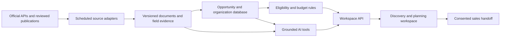

# AchieveDXP Grant Navigator: product review and upgrade roadmap

Reviewed November 4, 2026 (America/Boise), against commit `089b387b1358ca6e80bc74cc8eb171cc6215a98c`.

**Confirmed product direction:** a grant discovery and planning workspace that also generates qualified AchieveDXP leads.

**Primary outcome clarified by the user:** help DOC education teams identify overlooked funding, pursue viable direct or partner-led routes, and prepare stronger applications. Qualified implementation conversations are optional. No Nucleos pricing belongs in this product. Product success should be measured through source-verified opportunities, completed applications, and agency-reported awards with appropriate verification—not lead volume, displayed funding ceilings, or an invented chance-of-winning score.

This document separates observed repository behavior from proposed capabilities. New source integrations and AI capabilities below are recommendations, not implemented or live-verified services.

**Implementation follow-up (November 4, 2026, America/Los_Angeles):** the workspace upgrades address vendor pricing removal, source identity, consent, saved plans, federal search expansion, source-health preservation, agency opportunity imports, cited eligibility reviews, explained research priorities, broader funding strategies, and optional server-side OpenAI analysis. This audit describes the original commit; see [README.md](../README.md) for implemented capabilities and remaining coverage boundaries. The November 5 redesign now replaces the root wizard with a discovery/application/reporting workspace; the federal, award, and foundation refresh succeeded. Actual OpenAI generation encountered a credential-forwarding authentication failure. See the current README for evidence and release boundaries. State depth will follow demand after broad nationwide discovery coverage.

## 1. What the product was built to do

The Navigator helps U.S. corrections agencies turn an education or reentry program idea into a funding and procurement conversation with Nucleos and iT1. Its central promise is: find funding, compose a program, and produce a plan for delivering corrections education through AchieveDXP.

The users implied by the interface are state DOC education leaders, county jail administrators, juvenile justice agencies, community corrections/reentry teams, and their grant writers. The secondary audience is an executive, budget officer, or procurement approver receiving the generated report or letter of intent. The business customer on the other side is the Nucleos/iT1 sales team.

The current journey is:

1. Establish confidence through program outcomes, partner logos, compliance messaging, and bundled procurement.
2. Collect agency type, state, population, goals, infrastructure, budget, grant experience, timeline, and partners.
3. Require contact information before the standard wizard displays a report.
4. Generate a readiness score, modeled AchieveDXP improvement, matched program families, funding stack, program budget, partner suggestions, implementation roadmap, narrative, and procurement letter.
5. Send a lead; offer callback and Statement of Work requests. Mark a prospect high priority when the readiness score is at least 65 and the timeline is immediate.

The product's commercial logic is explicit in `buildLeadPayload()`, `computeReadinessScore()`, `requestSOW()`, and `buildLOI()` in [app.js](../app.js). The [privacy policy](../privacy.html) also describes the product as corrections-agency procurement planning.

**Keep:** the corrections specialization, approachable intake, program composition, executive summary, share/print flow, and contextual access to implementation experts. The expansion should make the plan independently useful while preserving an honest commercial handoff.

**Positioning:** “Find relevant funding for corrections education and reentry, understand what you qualify for, and build an evidence-backed plan—with implementation help when you need it.”

## 2. What exists today

| Area | Actual implementation |
| --- | --- |
| Application | Static HTML/CSS and a roughly 3,000-line browser JavaScript file; no application build step |
| Recommendations | 18 manually defined program families in `GRANTS`, with coarse agency/population filters and goal/timeline weights |
| Live federal data | Grants.gov Search2 queries for 16 fixed ALNs, capped at 25 rows per query, followed by opportunity detail hydration |
| Historical awards | USASpending queries for the ten largest awards per ALN in a rolling 24-month period |
| Foundation intelligence | ProPublica financial/filing data for 12 curated EINs; focus tags and pitches are manually assigned |
| State information | A static directory of 56 state/territory administering-agency entries |
| Refresh | A daily GitHub Action and an optional container background loop overwrite `opportunities.json` |
| Persistence | Browser localStorage for wizard progress and lead backups; URL fragments for profile sharing |
| Generated writing | Fixed JavaScript templates, not an LLM |
| Leads | Browser-to-Formsubmit requests; no durable server-side lead queue in this repository |
| Deployment | GitHub Pages documentation plus nginx container configuration and CircleCI publishing to Azure Container Registry |
| Tests | One Chromium happy-path test covering wizard, report, and mocked lead payloads |

The checked-in feed contains **4 federal opportunities, 81 historical awards, 12 foundation records, and 56 directory entries**. These are four different record types; they are not 153 open grants. The feed also contains **7 USASpending HTTP 503 errors**. Twenty-eight directory entries have `verify: true`, which means their contact information still needs verification. Foundation filings in this snapshot are from tax year 2023.

The referenced parent-project System Design document is not present here. Deployment topology outside this repository, actual customer outcomes, sales conversion rates, provider contracts, and compliance attestations were not independently verified.

## 3. Findings that should shape the upgrade

### A. Match actual solicitations, not just program numbers — critical

`applyFeed()` keeps one latest opportunity per CFDA/ALN. `sourceUrlFor()` and `liveRangeFor()` attach it to a curated program card using that number alone. ALNs describe assistance programs and do not uniquely identify solicitations or their intended uses.

**Reproduced:** the “Edward Byrne Memorial Justice Assistance Grant” card links to **OJP FY 2026 Integrity in American Elections Grant Program**, displaying its **$5 million** ceiling. Sharing ALN `16.738` does not establish corrections-education relevance.

**Change:** model individual opportunities and their versions; retain program families as educational context. Verify topic, applicant type, geography, funding purpose, and dates before attaching an opportunity to a recommendation. Use opportunity IDs for identity, and merge duplicate publications from authoritative sources.

Evidence: [app.js](../app.js), `applyFeed`, `matchGrants`, `liveRangeFor`, `sourceUrlFor`; [opportunities.json](../opportunities.json).

### B. Freshness and verification claims exceed the evidence — critical

`freshnessFor()` assigns NEW/UPDATED badges based on card position when there is no corresponding live opportunity. `lastFederalSync()` invents a 03:14 timestamp when no source timestamp exists. A closing date is used as a proxy for modification time. The source banner advertises weekly state updates, but the state directory is a static file. `fmtSyncTime()` labels the browser's local clock as ET without converting it.

**Reproduced:** a Second Chance Act card with no live record receives a NEW badge and a “Last verified from grants.gov” timestamp.

**Change:** show observed states such as open, forecasted, closed, historical, program guidance, stale, or needs verification. Store retrieval time, source publication/modification time, last successful refresh, and human-review time separately. Unknown must remain unknown.

### C. Funding and readiness are sales models, not eligibility decisions — critical

The readiness formula awards points for platform-related capabilities and adds them automatically for the AchieveDXP scenario. `computeEligibleCeiling(true)` multiplies selected award ceilings by **1.3**. `buildStack()` adds static ranges across funding layers without validating award terms, applicant eligibility, matching requirements, overlap, or whether funds may be combined.

**Reproduced:** the reference agency profile receives a 79 → 92 readiness comparison and a $1.425M–$8.1M funding range. These values are outputs of the model, not verified funding available to that agency. Changing Michigan to California produces the same program matches.

**Change:** separate application preparedness, per-opportunity eligibility, and the optional AchieveDXP implementation scenario. Label cost/funding assumptions explicitly. A budget scenario needs allowable-cost categories and non-overlapping allocations. Never imply a vendor purchase increases a funder's award ceiling or guarantees qualification.

### D. Existing coverage is narrower than the interface suggests — high

Matching reads the static `GRANTS` array; adding feed records alone will not create new program matches. Eight numeric ALNs referenced by the catalog are absent from the fetch list. Several program mappings also need authoritative review before expanding the list. Multiple ALNs stored in a display string cannot match a single-key lookup.

The Grants.gov connector has no pagination; the 600-character synopsis truncation cannot support reliable AI eligibility extraction. The state directory is a routing aid, not a feed of state opportunities. A DOJ administering office is not necessarily the administrator for education, workforce, or health funding.

**Change:** use one reviewed program taxonomy and explicit many-to-many ALN mappings. Preserve complete source text and attachments. Create separate state funding routes for justice, education, workforce, and health.

### E. Source failure can replace useful data with missing data — high

`refresh-all.mjs` catches upstream errors and writes the new arrays regardless. A failed source can become empty or partial while the aggregate receives a new sync timestamp. There are no explicit request deadlines, bounded retry/backoff policies, per-source freshness records, or atomic publication in these scripts. Hydration failures can be silent.

**Change:** preserve the last successful source partition, mark it stale, publish atomically after validation, and expose source health. Successful zero-result responses must be distinguished from failed requests. Snapshot document versions for reproducibility.

### F. Two user actions currently overstate completion — high

**Browser-reproduced:** `addToStack()` only shows a toast; it does not modify the stack. `submitCallback()` shows the success view in `.finally()`, including when the mocked endpoint returns HTTP 503. A localStorage backup does not provide server delivery or a retry service.

**Change:** implement durable plan membership and actual budget recalculation. Use acknowledged submission status, idempotent lead writes, retries, and user-visible recovery. Preserve a user's plan if sales delivery fails.

### G. The product is a report generator rather than a working workspace — high

There are no accounts, organization membership, saved opportunity lists, application stages, owners, tasks, document versions, or deadline-change alerts. Shared URLs reconstruct a profile; they do not preserve a specific source snapshot, customized program selections, or an immutable funding plan. The calendar export deliberately creates reminders 45 or 120 days out rather than using actual solicitation deadlines.

**Change:** provide persistent plans, explicit application states, verified deadlines and time zones, document history, and controlled sharing. Let people discover value before asking for a sales conversation.

### H. Quality coverage needs to follow the new workflow

The existing happy-path test is useful and passed during environment setup. It does not evaluate relevance, eligibility, bad source responses, stale data, callback failure, working stack edits, or AI faithfulness. Some accessibility foundations exist, including native wizard buttons and a radar-table fallback. The program builder uses clickable divs, and modal focus management needs review.

This review confirmed no horizontal overflow at a 390px report viewport and no uncaught errors on the sampled successful report path. That is not a complete accessibility or mobile certification. Browser probes blocked remote assets and mocked all lead traffic; no real lead was sent.

## 4. Expand sources by usefulness and evidence type

| Priority | Source or source family | What it adds | Integration approach / limitation |
| --- | --- | --- | --- |
| 1 | Grants.gov; evaluate Simpler.Grants.gov | Federal opportunity records, eligibility, deadlines, amendments, documents | Fix current coverage, pagination, identity, and full-text capture first. Simpler is an overlapping federal source, not an independent increase in available funding. Confirm current production API terms/auth before choosing an adapter. |
| 1 | DOJ/OJP: BJA, OJJDP, NIJ; DOL/ETA; Education; SAMHSA; USDA Rural Development | Relevant solicitation documents, FAQs, webinars, clarifications, and program guidance | Treat agency publications as authoritative enrichment and cross-checks. Deduplicate solicitations already present on Grants.gov. Review mappings for RSAT, COSSUP, reentry, adult education, workforce, and rural distance learning. |
| 1 | State justice, education, workforce, and behavioral-health portals | Subawards and formula/pass-through competitions an agency may actually access | Pilot states selected from the sales/customer pipeline. Build and maintain adapters per publisher; retain a reviewed manual import when no stable feed exists. Record whether the agency applies directly or through a partner. |
| 2 | Local workforce boards and regional/community foundations | Local partnerships and geographically relevant funding | Use official published opportunities and application policies. Treat directories as discovery leads until an active call and applicant fit are verified. |
| 2 | Foundation grant-program pages and open calls | Current philanthropic opportunities and invitation policies | Expand beyond the 12 EINs using mission, geography, applicant type, and history. Separate “potential funder” from “accepting applications.” |
| 2 | USASpending; ProPublica/IRS filings | Historical award benchmarks and funder research | Improve peer comparability and completeness. Historical awards, foundation assets, and old filings are not current funding availability. |
| 3 | Federal Register | Notices, amendments, regulations, and future-cycle signals | Use as a change/intelligence source. A notice is not automatically an open solicitation. |
| Optional | Licensed foundation/opportunity datasets, e.g. Candid | Coverage acceleration if commercial terms justify it | Validate availability, licensing, redistribution rights, cost, and API access before design depends on them. Do not assume a public scraping route. |

First-party reference reviewed: [HHS Simpler Grants repository](https://github.com/HHS/simpler-grants-gov), which describes Simpler as the modernization of Grants.gov. Additional source families above are integration candidates; their current endpoint behavior and access permissions have not been tested in this review.

Use distinct entities for **program**, **opportunity**, **opportunity version**, **historical award**, **funder**, and **funding route**. Every opportunity needs canonical/source IDs, authoritative URL, document version, title, funder, ALNs, geography, applicant types, eligible uses, amount basis, matching requirements, status, actual deadline/time zone, retrieval time, and field-level evidence. Missing eligibility facts should be recorded as missing, not inferred from an agency category.

## 5. AI tooling that would earn its place

The current templates are a starting point, but AI should operate on verified grant material and agency-provided facts.

| Capability | User-facing result | Required grounding |
| --- | --- | --- |
| Opportunity brief | “What does this fund, who can apply, and what should we do next?” | Cited solicitation sections, deadline, award limits, and document version |
| Eligibility assistant | Met / not met / unknown checklist and targeted follow-up questions | Deterministic rules where possible; quotes for each material requirement; distinguish direct applicant from partner/subrecipient |
| Natural-language discovery | “Find funding for a county jail GED and reentry program in my state” | Search structured records and approved documents; apply filters before ranking |
| Application workbench | Editable narrative, needs statement, work plan, budget justification, and requirements matrix | Selected solicitation rubric and verified agency facts; mark facts the applicant still must provide |
| Gap/action planner | Tasks, documents, partners, match-funding gaps, and timeline | Source requirements and verified deadlines, rather than generic vendor benefits |
| Change analyst | Explain what changed in an amendment and which plan sections are affected | Diff two preserved source versions |
| Sales handoff summary | A consented brief of goals, selected grants, implementation gaps, budget, and timing | The user's saved plan and explicit request for assistance |

Expose bounded tools such as `search_opportunities`, `get_opportunity_version`, `get_source_excerpt`, `check_eligibility`, `calculate_budget_scenario`, and `draft_plan_section`. The model should not invent authoritative URLs, award amounts, approvals, or deadlines, and should not submit applications or contact funders autonomously.

Use a server-side model integration with structured outputs and citation validation. Start with one provider behind a small adapter; evaluate model choice on extraction and grounded-writing quality rather than branding. Keep keys off the browser. Record model/prompt version, source versions, uncertainty, latency, and cost. Cache document extraction separately from user-specific drafting.

Treat retrieved documents as untrusted evidence, not tool instructions. Keep tool access scoped to the user's organization, minimize contact data sent to models, and revise the existing privacy disclosure before enabling AI processing. Do not introduce incarcerated-person records into a procurement-planning tool.

Release evaluation should cover correct and incorrect eligibility, missing/contradictory evidence, closed opportunities, multiple ALNs, duplicate publications, incomplete feeds, amendments, and malicious instructions embedded in source text. Reject generated claims whose citations do not support them. A missing model key should yield a clear unavailable state, not simulated AI output.

## 6. Recommended product and architecture

The workspace should center on four actions: **discover, compare, plan, and prepare**. An opportunity detail view should answer eligibility, deadlines, allowed costs, evidence, and next steps. A plan should hold selected opportunities, budget allocations, owners, tasks, documents, and a source snapshot. Contextual “Get implementation help” actions can preserve the AchieveDXP funnel without biasing grant eligibility.

An incremental architecture is appropriate:

Keep the existing marketing page and useful intake while extracting matching, eligibility, budgets, and source normalization from the monolithic browser file. Add a Node/TypeScript API, PostgreSQL, scheduled workers, and document/object storage. PostgreSQL full-text search is a reasonable starting point; add embeddings only where evaluation shows they improve retrieval. A React/TypeScript workspace is reasonable as complexity grows, but a framework migration alone does not improve funding accuracy.

The existing Azure container publishing setup makes container deployment a sensible starting assumption. Confirm the actual hosting environment before choosing Azure-specific managed services. GitHub Pages can continue to host public static content; authenticated persistence and private AI calls need a separate backend. Backend tests should mock external systems; staging must also verify real integrations before release.

## 7. Build order and acceptance criteria

| Milestone | Deliverable | Acceptance criteria |
| --- | --- | --- |
| 1 — Trust foundation | Correct opportunity identity, honest freshness, reviewable funding assumptions, working stack edits and lead failure states | Elections-grant collision regression passes; uncited records cannot claim verified/open status; no automatic 30% award uplift; stack edits change totals; failed lead delivery is visible and recoverable |
| 2 — Source expansion | Normalized source adapters, document evidence, broader federal coverage, initial state pilots, monitored refresh | Pagination and retry tests; deduplicated records; actual geography/applicant filtering; last successful data survives outages; manually checked relevance sample for each connector |
| 3 — Planning workspace | Persistent organization/profile, saved opportunities, comparison, budget scenarios, tasks, real deadlines, controlled sharing | Plans survive reload/device changes; access boundaries tested; allocations do not double count costs; exported deadlines match cited source time zones |
| 4 — AI assistance | Cited briefs, eligibility questions, and editable solicitation-specific drafting | Every material eligibility/amount/deadline claim is traceable to evidence; unknown facts are marked; model and source failures degrade clearly; human review precedes external actions |
| 5 — Production quality | Accessible/mobile workflows, operational monitoring, durable CRM handoff, source administration, privacy controls | Keyboard and assistive-technology review; browser/device regression; connector-health alerts; backup/restore and permission tests; validated CRM delivery and consent records |

A useful first release is narrower than nationwide grant management: reliable federal discovery plus selected state routes, saved funding plans, a grounded opportunity brief, and a qualified implementation handoff. Post-award accounting, automated submission, nationwide state coverage, and full collaborative grant administration can follow demonstrated demand.

Measure verified relevant opportunities per target profile, human-reviewed match precision, source freshness/failure recovery, time to a credible shortlist, saved-plan activation, repeat visits, qualified meeting conversion, and AI citation accuracy/cost. Define baselines first; do not claim these metrics have improved based on interface completion alone.

## 8. Validation and handoff

This review inspected the frontend, full source-refresh pipeline, data snapshot, deployment configuration, privacy language, and the existing end-to-end test. Targeted execution confirmed the ALN collision, state-independent matches, unsupported freshness badge, no-op stack action, and callback success after an intercepted HTTP 503. A sample report rendered at desktop and 390px mobile widths without uncaught JavaScript errors. No production writes, real lead delivery, or source refresh was performed.

Implementation decisions remaining for the relevant milestones: initial state markets, source licensing if applicable, model/provider account and budget, identity provider, hosting target, and CRM destination. These do not prevent the trust-foundation work. Provider credentials should be supplied through environment settings when integration work requires them, never in chat or frontend configuration.

Only this review document is added to the repository in this pass. Application behavior remains unchanged; source adapters, backend services, and AI features are proposed work.
